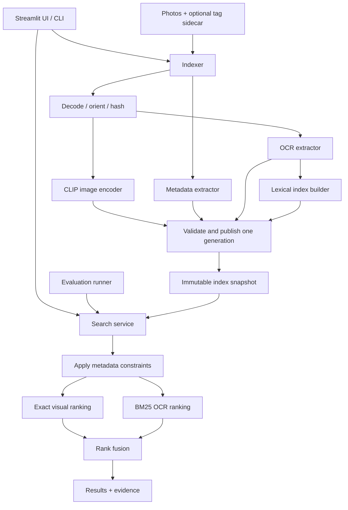

# Architecture and Design: Hybrid Photo Search

**Course:** CS 378AC — Final Project

**Status:** Proposed implementation design, updated November 16, 2026. The application is not implemented; quality and performance targets below are not measured results.

**Companions:** [Proposal](PROPOSAL.md), [requirements](REQUIREMENTS.md), and [milestones](TASKS.md).

## 1. Main decision and scope

Build **hybrid retrieval on a local, durable indexing foundation**: CLIP visual search, explicit metadata filters, and OCR text search combined through reciprocal rank fusion. Preserve the CLIP-only path as a baseline and fallback. This is design C built on design A from the architecture comparison.

The intended benefit is broader retrieval capability: visual concepts such as a beach, constraints such as a capture date or folder, and visible words such as a restaurant name. Better retrieval is a hypothesis to test on the intended collection. Adding a database or a faster vector index alone would not add those signals.

| Concern | Main design |
|---|---|
| Workload | One user, one active collection, initially 100–300 photos |
| Deployment | Local Python/Streamlit application on macOS or Linux; local filesystem |
| Visual retrieval | Pinned CLIP ViT-B/32, CPU float32, normalized vectors, exact NumPy dot product |
| Metadata | EXIF capture dates, relative folder paths, user-supplied tags |
| Text retrieval | Local Tesseract OCR; versioned tokenization and BM25 ranking |
| Combination | Hard metadata filters first, then weighted reciprocal rank fusion of visual and OCR ranks |
| Persistence | Immutable generations containing vectors, metadata, OCR, and lexical index artifacts |
| Updates | Explicit rescans; reuse each feature using its content hash and extractor signature |
| UI | Query, mode, filters, ranked gallery, OCR evidence, original-image view and download |
| Offline use | Local processing after dependencies, CLIP assets, and OCR language data are prepared |
| Evaluation | Shared production searcher; independent metrics; frozen human judgments; component ablations |

Implement this in stages: establish CLIP-only correctness, add one useful retrieval signal, measure it, then add the other. Choose metadata or OCR first from development-query failures and available data. Both are specified here as the target hybrid design; generated captions and reranking are later extensions, not prerequisites.

This extends the earlier documents' CLIP-only scope and OCR exclusion. The original 15-query CLIP acceptance test remains unchanged and is reported separately from new hybrid experiments. Do not relabel its results as hybrid performance.

The first version supports static JPEG, PNG, and WebP, with case-insensitive extensions. Reject multi-frame files explicitly. HEIC/RAW, face identification, filesystem watchers, remote clients, multi-user access, and autonomous natural-language filter parsing are outside this version. The smallest fallback remains one fixed, pre-indexed collection with CLIP text search and a gallery.

## 2. Components and data flow



The visual ranker uses CLIP's matching text encoder at query time. Text-only search bypasses CLIP. Metadata is a constraint channel, not an extra relevance score. Indexing and querying use the same published generation across all channels.

| Module | Responsibility and boundary |
|---|---|
| `src/types.py` | Typed records, feature specifications, requests, snapshots, results, reports, errors; no I/O |
| `src/image_io.py` | Read/hash bytes, fully decode, EXIF orientation, RGB conversion, thumbnails |
| `src/clip_encoder.py` | Load CLIP/processor once; image/text features and normalization; no persistence |
| `src/metadata.py` | Parse capture date, derive folder, validate tag sidecar, apply filter predicates |
| `src/ocr.py` | Pinned OCR process, timeout, TSV parsing, word boxes and extraction status |
| `src/lexical.py` | Tokenization, postings/statistics, BM25; no model inference |
| `src/fusion.py` | Pure rank-fusion function and deterministic tie-breaking |
| `src/indexer.py` | Scan, plan feature reuse, extract missing features, assemble complete candidate |
| `src/index_store.py` | Writer lock, schema/checksum validation, generation load and atomic publication |
| `src/searcher.py` | Validate request, filter, run selected channels, fuse, return evidence |
| `src/cli.py`, `app.py` | Thin command-line/UI adapters over the core |
| `eval/` | Independent baseline/metrics, ablations, timing reports; never supplies labels to retrieval |

Core contracts, shown as pseudocode:

```python
Encoder.spec -> EncoderSpec
Encoder.encode_images(images) -> float32[N, D]
Encoder.encode_text(query) -> float32[D]
OCR.extract(oriented_image) -> OCRRecord

build_or_load(root, index_dir, pipeline_spec, refresh=None) -> BuildReport
load_current(index_dir) -> IndexSnapshot
validate_capabilities(snapshot, request, pipeline_spec) -> None
publish(index_dir, candidate) -> IndexSnapshot
search(snapshot, request, encoder, retrieval_config) -> SearchResponse
```

The store first validates structural integrity independently of today's configured model. The indexer can then reuse compatible channels from that snapshot even if another channel's signature changed. The searcher separately requires compatibility for the channels the request uses.

`BuildReport` includes generation ID, indexed/skipped counts, feature-specific computed/reused/error counts, coverage, orphaned metadata keys, and stage timings. Count unique content computations separately from file records.

`SearchResponse` includes generation ID, retrieval-configuration hash, applied filters, mode, coverage warnings, timings, and ordered results. A result has relative path, final score and score kind, optional visual/BM25 scores and ranks, matched OCR terms/snippet, and metadata. Scores are never presented as probabilities.

## 3. Requests and user workflow

### 3.1 Request contract

```json
{
  "text": "ramen menu",
  "mode": "hybrid",
  "k": 5,
  "filters": {
    "capture_date_from": "2026-07-01",
    "capture_date_to": "2026-07-31",
    "folder": "travel",
    "tags_all": ["vacation"]
  }
}
```

Supported modes:

| Mode | Behavior |
|---|---|
| `visual` | CLIP ranking over eligible images; the comparison baseline |
| `hybrid` | CLIP and positive-match OCR rankings over the same eligible set, then fusion |
| `text` | OCR BM25 only; excludes zero-match documents and does not run CLIP |

Dates, folders, and tags are explicit UI controls. For example, the user enters “beach” and selects July, rather than expecting “last summer” to become an invisible date constraint. Text-only mode means matching recognized words, not exact phrase search or guaranteed transcription.

Empty text with active filters browses the matching photos in path order without model inference; empty text without filters shows a query prompt. Validate filter types and positive integer `k` before execution. Default `k=5`; the UI offers up to 20.

The target hybrid release defaults to `hybrid` after the development gate in section 9. Until then, `visual` remains the default and hybrid is an explicitly selected experiment. A generation built without OCR cannot silently satisfy a hybrid/text request: explain the missing capability and offer a rescan or visual mode.

### 3.2 Workflow

1. Select a root and index directory. Changing roots clears active results and requires validation before search.
2. Build/load: scan photos and the optional metadata sidecar, compare signatures, reuse compatible features, and publish a complete generation if anything changed.
3. Submit a query with mode/filters. Capture one snapshot; apply constraints before either ranking channel.
4. Show ranked thumbnails with capture dates/tags where known and a small OCR match excerpt where applicable. Advanced details may expose component scores.
5. Select a result to view/download the original. Read and hash those bytes before serving them; a changed or missing original gets a rescan message instead of being shown under an old score.
6. Rescan explicitly after edits. Display scan time, indexed count, metadata availability, OCR completion, and feature failures.
7. On restart, validate the saved generation and collection inputs. Reuse extracted features; model loading, hashing, and index loading still take time.

Indexing is synchronous in the initiating UI session. No watcher or scan runs on each keystroke. A generation represents observed inputs at scan time, not a permanently current view of a changing folder.

## 4. Data contracts and portable artifacts

### 4.1 Photo identity and source metadata

The record key is a collection-relative POSIX path preserving case. Reject absolute paths and `..` components; do not follow symlinks in this version. Sort records by relative-path UTF-8 bytes. Matrix row `i` corresponds to record `i`; use the same order for tie-breaking.

SHA-256 identifies raw image bytes, separately from the path. Renames can reuse content-derived features but change the record key and folder metadata. Duplicate bytes at two paths remain two photos; they share extraction work. Tags belong to paths and are not transferred by content hash, because duplicate files may intentionally have different tags.

Absolute roots stay in runtime configuration. Moving an unchanged collection and index together preserves relative-path mappings. `images/MANIFEST.csv` records public-demo sources/licenses; source-page text and licenses are not retrieval inputs.

### 4.2 User tag sidecar

An optional `collection.metadata.json` at the selected root supplies tags:

```json
{
  "schema_version": 1,
  "images": {
    "travel/menu.jpg": {
      "tags": ["Vacation", "food"]
    }
  }
}
```

Normalize tags with Unicode NFKC, trimming and case-folding; drop empty/duplicate tags and sort them. Preserve display labels if needed, but filter using normalized values. A missing sidecar means no user tags. Malformed JSON, invalid values, or invalid paths abort the candidate build; unknown image paths are reported as orphaned entries and are never reassigned.

This version reads tags from the sidecar; it does not add an in-app tag editor or infer tags from queries. A rename requires the user to update the sidecar if tags should follow it.

### 4.3 Generation layout

```text
index/
├── CURRENT.json
├── .write.lock
├── .staging/
│   └── <build-id>/
├── generations/
│   └── <generation-id>/
│       ├── embeddings.npy
│       ├── manifest.json
│       ├── metadata.json
│       ├── ocr.json
│       ├── lexical.json
│       └── fingerprint.json
└── thumbnails/
    └── v1/
        └── <content-sha256>.jpg
```

`CURRENT.json` contains schema version, generation ID, and fingerprint-file SHA-256. Read it once, then load only that generation. Validate the ID as a single directory-name component under `generations/`; never guess the active generation from timestamps.

| Artifact | Contract |
|---|---|
| `manifest.json` | Generation ID, ordered successful photo records, and all discovered supported input paths/hashes/statuses |
| `embeddings.npy` | Float32 `(N, D)` matrix with normalized rows; CLIP ViT-B/32 has `D=512`, read from its specification |
| `metadata.json` | One entry per successful photo: content hash, relative folder, capture date/local timestamp/offset/source, normalized tags, warnings |
| `ocr.json` | One entry per successful photo: content hash, OCR signature, status, words with confidence/boxes, and error code if any |
| `lexical.json` | Analyzer signature, per-photo token counts, document lengths, corpus statistics, and term postings referencing photo keys |
| `fingerprint.json` | Feature specs/signatures, input hashes, capabilities, counts, dimensions, artifact checksums, build/environment provenance |

All JSON artifacts include schema version and generation ID. Successful records contain relative path, content SHA-256, byte size, and dimensions after orientation. Discovered-but-skipped files appear only in manifest inputs with a stable error code. Read failures have a null hash and must be retried on rescan.

Metadata and OCR key sets exactly equal the successful record set, including entries with unknown metadata, no recognized text, or disabled OCR. Lexical document lengths include every successful record, using zero for empty/disabled/failed OCR. Postings contain only valid record keys.

An illustrative OCR record, with word coordinates expressed as `[x, y, width, height]` in the oriented original image:

```json
{
  "relative_path": "travel/menu.jpg",
  "content_sha256": "<sha256>",
  "ocr_signature": "<signature>",
  "status": "ok",
  "words": [
    {"text": "Ramen", "confidence": 92.0, "box": [120, 300, 200, 40]}
  ],
  "error_code": null
}
```

Keep raw nonempty OCR word outputs so changing a confidence cutoff or tokenizer can rebuild the lexical index without rerunning OCR. Store errors as concise codes; detailed diagnostics belong in the build report.

Thumbnails are disposable JPEGs, maximum edge 256 pixels, with orientation and white alpha compositing applied. They preserve aspect ratio and do not use CLIP's center crop. Cache by image hash and thumbnail policy version; regenerate only from matching original bytes. A missing thumbnail does not invalidate retrieval artifacts.

### 4.4 Signatures and input hashes

Use a planned `pipeline.lock.json` to pin model/extractor assets and preprocessing. Use `retrieval.json` for query-time BM25/RRF parameters and default mode. Resolve exact versions and asset hashes during setup; runtime never silently follows a model repository's `main` branch.

| Signature/hash | Includes | Changing it requires |
|---|---|---|
| Visual signature | Model/processor/tokenizer revisions, effective preprocessing, dimension, normalization, CPU/precision profile, Torch/Transformers/Pillow/NumPy versions | Recompute visual embeddings; compatible OCR can remain |
| Metadata extractor signature | EXIF parsing/date policy, normalization and parser/library versions | Re-extract metadata; no visual or OCR inference solely for this change |
| OCR signature | Engine version, language-data checksums, languages, OCR flags, image preparation policy and relevant library versions | Re-extract OCR; visual embeddings can remain |
| Lexical analyzer signature | Unicode/tokenization policy, word-confidence cutoff, index-format version | Rebuild lexical artifacts from raw OCR |
| Fileset hash | Sorted relative paths and readable content hashes; explicit null for read failures | Reconcile changed/added/deleted/renamed records |
| Metadata input hash | Sidecar bytes, or an explicit absent marker | Rebuild path-specific tags/metadata |
| Retrieval configuration hash | Mode defaults, BM25 parameters, fusion constant and weights | Invalidate cached query results; no feature extraction |

Hash canonical UTF-8 JSON with sorted object keys, fixed separators, finite numbers, and explicitly ordered lists. Recompute and check signatures when loading; a stored string alone is not evidence of compatibility. Unknown/mismatched schema versions fail clearly.

`fingerprint.json` includes SHA-256 checksums for all five data artifacts, feature availability/coverage counts, schema/generation ID, creation time, code revision and dirty status, Python/library/platform details, and build parameters. The pointer authenticates the fingerprint against accidental mixing, not against malicious modification.

## 5. Feature extraction and reuse

### 5.1 Shared image preparation and visual features

Read and hash the same raw bytes later used for decoding. Fully decode within the per-file error boundary: Pillow image opening is lazy, so catching only `Image.open()` is insufficient. Apply EXIF orientation, composite transparency over white, and convert to RGB. Reject multi-frame inputs explicitly. Keep existing Pillow image-size protections. [Pillow image loading](https://pillow.readthedocs.io/en/stable/reference/Image.html#PIL.Image.open)

CLIP uses its pinned processor on that image. Load the model once, call `model.eval()`, run in `torch.inference_mode()`, and normalize projected image/text features. Reject zero-norm or non-finite vectors. CPU float32 is the reference profile; changing device/precision uses a new visual signature.

Start with image batches of 16 and release decoded originals after processing. Record batch size for reproducibility. Counting, fine distinctions, and detailed relations remain model limitations to evaluate. [CLIP model card](https://huggingface.co/openai/clip-vit-base-patch32)

### 5.2 Metadata extraction and semantics

Read EXIF `DateTimeOriginal` and its offset when present. Store the camera-local timestamp, optional offset, derived local capture date, and provenance. If the timestamp is missing or invalid, the capture date is null with an appropriate status. Never substitute filesystem modification time or assume a timezone. Date filtering compares recorded local calendar dates, not guessed UTC instants.

Folder comes from the relative parent path; tags come from the sidecar. Image-derived EXIF fields can be reused by image hash plus metadata extractor signature, but folder/tags are recomputed for the current path and sidecar. Do not infer names, locations, or tags from image content in this phase.

All filter predicates are explicit:

- Start/end capture dates are inclusive; reject a reversed range. Unknown capture dates do not satisfy an active date constraint.
- A folder matches that exact folder and its descendants, using path components rather than string prefixes.
- Every selected tag must be present; no selected tags imposes no tag constraint.
- Different filter types combine with AND. Missing metadata never causes a constraint to be relaxed silently.

### 5.3 OCR extraction

Use a pinned Tesseract 5 executable through `subprocess` argument arrays, without a shell or a separate Python wrapper. Prepare an oriented RGB image with longest edge at most 2000 pixels, never upscaling. Use English language data initially, LSTM engine `--oem 1`, sparse-text segmentation `--psm 11`, and TSV word output. These are starting settings to evaluate, not optimal settings assumed for all photos. Tesseract documents the engine flags, segmentation modes, language selection, and TSV format. [Command-line usage](https://tesseract-ocr.github.io/tessdoc/Command-Line-Usage.html), [Tesseract manual](https://github.com/tesseract-ocr/tesseract/blob/main/doc/tesseract.1.asc)

Record the exact engine version and trained-data checksum. Apply a ten-second per-image timeout initially, execute OCR serially to bound memory, and remove temporary input files after completion. OCR runs once per unique content/signature, not per query. Map TSV word boxes back to oriented original coordinates and preserve the returned word order for snippets.

Statuses are `ok`, `no_text`, `error`, and `disabled`. A successful run with no word output is `no_text`, not an error. Retain all valid nonempty word rows; confidence filtering happens during lexical analysis. OCR confidence is an engine score, not a calibrated probability.

A per-image timeout or extraction error keeps the valid visual photo searchable and marks OCR coverage incomplete; retry it on the next explicit scan. A missing executable/language asset aborts a build that needs new OCR. A fully cached generation can still be searched without the OCR executable. If every attempted OCR extraction fails and the nonempty candidate has no completed `ok` or `no_text` entries, including reused entries, fail the candidate instead of presenting it as a working OCR index. A successful collection-wide `no_text` result is valid and has zero lexical matches.

### 5.4 Lexical analysis

Initially retain words with OCR confidence at least 30, normalize with Unicode NFKC and case-folding, and split into maximal Unicode alphanumeric runs. Do not stem or remove stop words. Apply the same normalization/tokenization to queries; repeated query terms count once. The cutoff is a tunable development choice recorded in the analyzer signature.

Build term frequencies, document lengths, document frequencies, and postings over the whole successful photo set. Include zero-length documents for no-text/error/disabled entries. Do not include filenames, tags, EXIF fields, source captions, or generated captions in the OCR text channel. This keeps the new signal attributable to recognized image text.

Rebuild these small corpus-wide statistics whenever the photo set or retained tokens change. Deleting a document changes IDF even when every remaining OCR output is reused.

## 6. Index lifecycle and consistent publication

1. Acquire an exclusive nonblocking writer lock for the index directory for the full operation. The reference POSIX implementation uses `fcntl.flock`; competing writers return a busy status and the OS releases the lock when its owning process exits. [Python locking](https://docs.python.org/3/library/fcntl.html#fcntl.flock)
2. Structurally validate the current generation, if any. A damaged generation is not a reuse source. A valid generation with one changed extractor signature can still supply other compatible features.
3. Discover supported images in path order, excluding generated index/cache directories. Directory traversal errors abort rather than treating unseen files as deletions.
4. Hash images and read/validate the sidecar. If inputs, required feature signatures, and capabilities match, and no retryable read/OCR errors exist, return the current generation without extraction.
5. Plan reuse per feature. Match content-derived features by image hash plus that feature's signature. Recompute path-specific metadata. Decode fresh content once where practical and feed the separate visual/OCR preparation paths.
6. Compute missing features and thumbnails; preserve per-file failures. A model/inference/resource failure is a build failure, not a corrupt-photo classification. Individual decode/read failures skip the photo.
7. Assemble all artifacts for the new record set. Reuse immutable feature values but rewrite the small complete generation. Remove deleted records and rebuild lexical statistics as needed.
8. Rescan/hash images and reread the sidecar before publication. Abort on observed changes to paths, readable hashes, read-error states, or sidecar hash. This detects observed edits during the build; it does not lock the user's folder against subsequent edits.
9. Validate the candidate, publish atomically, and report counts/coverage/timings. Switch the UI to the new generation only after publication succeeds.

A truly empty folder may publish an empty matrix and empty companion artifacts. A nonempty supported set with no successfully decoded photos fails and preserves the current generation. Unchanged corrupt bytes may reuse their decode-failure classification under the same decoding policy; unreadable inputs and OCR errors are retried.

A diagnostic refresh option can force visual extraction, OCR extraction, or both, without bypassing validation. Changing tags or fusion weights must never force image inference merely because a global build configuration changed.

### 6.1 Validation

Reject an artifact set unless:

- Schema/generation IDs and checksums agree; paths are unique, ordered where specified, and valid relative paths.
- Manifest inputs reproduce the fileset hash, and indexed records agree with their input hashes.
- Metadata/OCR entries cover exactly the indexed records and agree with their content hashes and feature signatures.
- NumPy loads with `allow_pickle=False`; dtype is float32, shape is `(N, D)`, values are finite, and each nonempty vector norm is within `1e-5` of one.
- Lexical postings reference existing records, counts are nonnegative, and lengths/document frequencies/statistics agree with the retained OCR tokens. Validation can reconstruct this small index deterministically.
- Required capabilities and feature specs are present. A query may only use a compatible visual encoder and the analyzer under which the lexical artifact was built.

Mark loaded arrays and records read-only. Checksums detect damaged/mixed artifacts but do not prove that a correctly serialized vector or OCR record belongs to the intended photo; controlled association tests provide that evidence.

### 6.2 Publication and recovery

Write a unique staging directory on the same filesystem as the final generations and pointer. Write all five data artifacts, compute checksums, then write the fingerprint. Validate using the candidate's proposed pointer metadata, flush/sync files, and sync directories where supported. Rename the staging directory to its unique final path. Finally write/sync a temporary pointer and atomically replace `CURRENT.json`; this is the sole publication point. [Python atomic replacement](https://docs.python.org/3/library/os.html#os.replace)

An interruption before publication leaves the old generation active; afterward, readers see the complete new generation. A failed first build leaves no searchable index. Readers holding an old snapshot keep it throughout their query. Ignore unpublished/unreferenced directories rather than guessing which is newest.

Retain previous generations in this version; cleanup occurs with the app stopped. This spends disk space to avoid deleting files still in use. Test process-interruption recovery explicitly. Power-loss durability depends on platform/filesystem synchronization and is not established by that test alone.

## 7. Retrieval algorithm and result evidence

### 7.1 Filter first, then rank

Validate the request and capture one generation. Apply all metadata predicates to produce the eligible record set. If it is empty, return an empty result with the applied filters; do not remove constraints to find more photos.

For a nonempty visual/hybrid query, tokenize using the pinned CLIP tokenizer and reject text exceeding its token limit, including special tokens. Do not silently truncate. Text-only mode does not use the CLIP token limit. Apply an independent 2000-character query cap to every mode for predictable input handling.

Empty text with filters performs the browse behavior from section 3. Otherwise, nonempty queries proceed to the requested channels.

### 7.2 Visual channel

Normalize text vector `q`; compute `E_eligible @ q`. Order by descending cosine score and then path bytes. Score every eligible image at this collection size. This path is also the exact CLIP baseline, with no OCR or metadata-derived score bonuses.

### 7.3 OCR channel

Use BM25 with initial `k1=1.2` and `b=0.75`. For each unique query token `t`:

```text
idf(t) = ln(1 + (N - df(t) + 0.5) / (df(t) + 0.5))
contribution(t, d) =
    idf(t) * tf(t,d) * (k1 + 1)
    / (tf(t,d) + k1 * (1 - b + b * length(d) / avg_length))
BM25(d, q) = sum(contribution(t, d) for distinct query tokens)
```

`N` is the full generation's successful image count, including zero-length OCR documents. Compute average length over that same population. Statistics stay fixed when filters change; only eligible documents are scored/returned. If `N=0` or average length is zero, return no lexical candidates. Absent query terms contribute zero.

Return only strictly positive BM25 matches, ordered by score then path bytes. Zero-score documents never receive a fabricated lexical rank. These BM25 parameter/IDF choices follow a common documented formulation; this project implements the small scorer directly and does not require Lucene. [Lucene BM25 reference](https://lucene.apache.org/core/9_12_3/core/org/apache/lucene/search/similarities/BM25Similarity.html)

### 7.4 Rank fusion

For hybrid mode, use rank-based fusion rather than adding raw cosine and BM25 values with incompatible scales:

```text
fusion(d) = w_visual / (c + rank_visual(d))
          + w_ocr / (c + rank_ocr(d))

initial settings: c = 60, w_visual = 1, w_ocr = 1
ranks start at 1; a missing channel rank contributes 0
```

The constant is a starting point from reciprocal rank fusion, not proof that equal weights are optimal for this collection. Freeze any tuned weights using development data before held-out evaluation. [Original RRF paper](https://cormack.uwaterloo.ca/cormack/cormacksigir09-rrf.pdf)

At 100–300 images, rank the complete eligible set visually and all positive OCR matches, then fuse their union. Do not truncate a channel to five candidates before fusion. Break equal fused scores by path bytes; return at most `k` distinct paths. If no positive OCR match exists, use the exact visual order and identify the fallback in the response.

Illustrative ranks, not measured photo results:

| Photo | Visual rank | OCR rank | Fused score with the initial settings |
|---|---|---|---|
| A | 1 | absent | 1/61 ≈ 0.016393 |
| B | 2 | 2 | 2/62 ≈ 0.032258 |
| C | 3 | 1 | 1/63 + 1/61 ≈ 0.032266 |

The combined order is C, B, A. This illustrates that OCR can materially change results, including incorrectly if recognized words are noisy. Compare against the visual-only path and retain a user-selectable mode.

### 7.5 Empty results and explanations

Text-only mode can return no recognized-word matches. Visual/hybrid mode returns nearest available eligible images even when none is truly relevant; there is no calibrated semantic abstention threshold in this version. Do not claim that “no OCR match” means the original contains no text, particularly when extraction failed.

Show evidence such as “Recognized text: Ramen” and applied date/folder/tag constraints. OCR is a fallible transcription. Keep cosine, BM25, and fused scores separately typed and available for diagnostics; none is a confidence percentage. Explanations describe the contributing channel, not a generated assertion about what the image proves.

Use deterministic path tie-breaking. Reloads should reproduce ranks in the pinned reference environment; fresh inference comparisons use declared tolerances and inspect near-ties. Arbitrary hardware/library combinations need not produce identical floating-point results. [PyTorch reproducibility](https://docs.pytorch.org/docs/stable/notes/randomness.html)

## 8. UI lifecycle and failure behavior

Cache the CLIP resource by visual signature and a validated read-only snapshot by canonical index directory and generation ID. Query-result caching, if added, includes generation ID, normalized request including filters/mode, and retrieval-configuration hash. Rebuilding a lexical artifact or changing RRF weights must not reuse stale query results. Streamlit reruns the script on interactions and resource caches share objects. [Streamlit caching](https://docs.streamlit.io/develop/concepts/architecture/caching)

Keep root, active generation, filters, mode, query, and results in session state. A failed update may leave the previous snapshot searchable only for the same selected root and compatible requested channels. A new generation atomically changes vectors, OCR, metadata, and lexical statistics together.

Display OCR completion separately from text presence: completed means `ok` or `no_text`; indexed-text coverage means documents with retained tokens. Show unknown-date counts and per-channel errors. A user must be able to tell an absent match from an unavailable channel.

| Condition | Required behavior |
|---|---|
| Invalid root or incomplete directory traversal | Abort candidate; preserve published generation |
| Corrupt/unreadable/multi-frame image | Skip with reason; do not shift other record associations |
| Invalid tag sidecar | Abort candidate; avoid publishing unintended filter changes |
| Unknown sidecar paths | Report orphaned tags; do not transfer them to other files |
| Missing/invalid capture date | Keep photo; exclude it only when an active date filter requires a known date |
| Image/sidecar changes during build | Abort candidate and request rescan |
| CLIP model missing or inference/resource failure | Fail operations that need it; preserve prior compatible snapshot |
| OCR tool/assets missing when extraction is needed | Fail that hybrid build; an explicit visual-only build remains available |
| Per-photo OCR error/timeout | Preserve visual entry; mark partial OCR coverage; retry on rescan |
| All required OCR work fails with no completed `ok`/`no_text` entries | Fail candidate; do not label it a functioning hybrid build |
| Unsupported mode/capability | Explain missing channel; no silent mode change |
| Invalid checksum/schema/vector/posting reference | Refuse that generation and offer explicit rebuild |
| Disk full, competing writer, interrupted publication | Preserve old or complete new generation under the publication protocol |
| Missing/changed original | Explain stale result; never serve unrelated bytes under its old score |
| Missing thumbnail | Regenerate from hash-matching bytes or display placeholder |
| No eligible photos / no positive text matches | Return a clear empty state; retain requested constraints |

Bind the local server to localhost. Folder paths refer to the machine running Streamlit. Remote uploads and per-user storage/access are a different deployment design. [Streamlit client/server architecture](https://docs.streamlit.io/develop/concepts/architecture/architecture)

## 9. Evaluation and acceptance

### 9.1 Preserve the original claim

Use **mean precision@5**, clarifying the earlier phrase “average precision@5”; this is not the distinct average-precision ranking metric:

```text
P@5(q) = relevant distinct image records among the first five results / 5
mean P@5 = sum(P@5(q) for the original 15 queries) / 15
original acceptance:
    CLIP-only mean P@5 >= 0.60
    CLIP-only mean P@5 - filename baseline mean P@5 >= 0.20
```

Run this in visual mode with no added filters. Report hybrid on the same queries as an additional comparison, never substitute it for the original CLIP claim. With 75 slots, the targets require 45 relevant slots and 15 extra relevant slots over the filename baseline. One changed judgment moves the mean about 0.0133.

The original collection/queries/labels are human-owned and frozen before tuning. Agents must not inspect or modify protected relevance labels. Implement metrics against independent synthetic fixtures; the human executes final acceptance and records the decision. The evaluator reads labels at evaluation time; runtime indexing/search never receives them.

Fail evaluation for placeholder queries, missing judgments, unknown paths, repeated result IDs, non-finite scores, incompatible artifacts, or missing/skipped benchmark photos. Keep denominator five when a ranker returns fewer results. Do not silently drop difficult inputs. The human must judge the collection adequately and review exact/near duplicates before freezing it.

Map existing repository-relative label paths to collection-relative keys in the evaluator without rewriting labels; reject references outside the chosen collection.

### 9.2 Baselines and hybrid ablations

Retain the independent filename baseline: unique-token overlap after case-folding and `[a-z0-9]+` tokenization of the stored filename stem/query; path-order ties. Record filename conventions. Include the analytic random-reference expectation `relevant_count / corpus_size` where at least five corpus items exist.

Create a **separate human-owned hybrid benchmark**, with a development split and untouched held-out split. This does not alter the original 15 queries. Include:

- Visual concepts with no useful recognized text.
- Literal words in menus, signs, screenshots, and similar text-bearing photos.
- Date/folder/tag constraints, including unknown-date cases.
- Combined requests such as a visual description plus an explicit date range.
- No-match and partial-match cases, evaluated separately from positive-query P@5.

Freeze metadata/tags before relevance labeling and system tuning. Do not create tags, filenames, captions, or OCR corrections from the evaluation queries or judgments. If the collection lacks trustworthy dates or useful text, document that limitation and assemble a separate representative benchmark rather than inventing metadata.

| Variant | Purpose |
|---|---|
| V: CLIP only, unfiltered | Visual quality reference and original acceptance path |
| V+M: CLIP with explicit metadata filters | Isolate constraint handling and the effect of available metadata |
| T: OCR BM25 only | Establish literal-word retrieval capability and OCR weaknesses |
| V+T: Visual/OCR fusion, unfiltered | Isolate fusion benefit and visual-query regressions |
| V+M+T: Full hybrid | Evaluate the proposed user workflow |
| Optional caption/reranker/encoder variant | One further change at a time after core hybrid results |

For V versus V+T, use identical unfiltered requests and corpus. For constrained requests, compare V+M against V+M+T with the **same filters and eligible set** to isolate OCR's effect. Separately compare against V with relevance judgments that include the constraint, explicitly attributing any gain to filtering. Never claim a model improvement from silently giving one system an easier candidate set.

Report per-query and per-category P@5, paired differences, filter-violation count, metadata availability, OCR completion/text coverage, and end-to-end latency. Add reciprocal rank for queries with one intended photo; report no-match false positives separately. Small curated samples support a project-specific conclusion, not universal superiority.

Initial hybrid promotion gate: zero filter violations and all correctness tests pass; on the frozen development protocol, at least +0.05 absolute mean P@5 over the corresponding visual baseline on positive OCR/combined queries, with at most 0.02 mean P@5 loss on visual-only queries, and the latency targets in section 10. These are proposed engineering thresholds to freeze before tuning, not observed gains or replacements for the original acceptance requirement. Report held-out outcomes even when the gate fails; retain visual mode as the default if the extension is not justified.

For an acceptance run claiming complete OCR support, require all benchmark images to finish OCR with `ok` or `no_text`. Partial-coverage failure experiments are reported separately, not mixed into a silently reduced corpus.

### 9.3 Correctness and failure tests

| Test | Independent expected result |
|---|---|
| Hand-calculated vectors, BM25 corpus, and RRF ranks | Correct scores/order, one-based ranks, missing-channel zero contribution |
| No positive lexical matches | Hybrid returns exactly the visual order |
| OCR matches outside visual top five | They remain eligible for fusion |
| Duplicate query words and empty lexical corpus | No unintended query-frequency boost or division by zero |
| Controlled fake extractors on tiny images | Vectors, OCR words, metadata, and paths stay associated |
| Corrupt file between valid images / deliberate association swaps | No row shift; controlled association test catches a swap |
| Strict date/folder/tag predicates | No filter violation; unknown dates do not pass date constraints |
| Empty query with/without filters | Browse only when requested; no accidental model inference |
| Same filename with changed bytes | Recompute affected content features |
| Rename / delete / duplicate bytes | Reuse content extraction, refresh path metadata, remove stale postings, preserve distinct paths |
| Sidecar-only edit | Refresh tags, invalidate filtered results, zero image/OCR inference |
| OCR signature or analyzer change | Recompute only OCR or lexical features as appropriate |
| Fusion-weight change | Query-cache invalidation without feature reindex |
| Forced OCR timeout or missing tool | Correct partial/fatal status; no mistaken no-text classification |
| Interrupted publication / malformed artifact / mixed generations | Old or complete new generation, or explicit load rejection |
| Reload and relocated collection/index | Same reference-environment results and portable paths |
| Missing or modified original | Result cannot serve mismatched bytes |

Checksums and restart equality complement these tests but cannot independently prove correct feature-to-photo associations. Real-model quality tests remain separate from deterministic software fixtures.

### 9.4 Evidence artifacts

Record code revision/dirty status, pipeline and retrieval configurations, data/sidecar/query/label hashes, generation ID, environment, per-query constraints/rankings/channel scores, metrics, coverage, and timings in machine-readable reports. Preserve actual human acceptance decisions in the project documentation.

Commit only reports for public demo data; private collection artifacts remain local. Query-level timing repetitions do not create additional independent relevance judgments.

## 10. Performance, dependencies, and offline operation

### 10.1 Measurements and targets

Exact visual scoring costs `O(ND)`; sorting costs `O(N log N)`. Raw CLIP vectors use `N * 512 * 4` bytes: about 0.59 MiB for 300 photos, 19.5 MiB for 10,000, and 195 MiB for 100,000. This excludes model memory, OCR/lexical metadata, decoding, thumbnails, and retained generations. No sub-millisecond total-latency claim is made.

Measure:

- Model cold load from already-downloaded assets.
- Full build with separate hashing, visual inference, metadata, OCR, lexical, and publication times.
- Fresh-process cached startup including input verification.
- Warm query time split into filtering, text encoding, visual scoring, BM25, fusion, and gallery rendering.
- Add/edit/rename/delete, tag-only, OCR-only, and tokenizer-only updates, with exact extraction counts.
- Peak memory including the OCR child process, current/retained generation sizes, and thumbnail cache size.
- OCR timeout rate and text coverage; extraction time alone does not establish usefulness.

Use the same reference machine/configuration, at least five fresh-process build/startup runs, and 100 warm query executions over a fixed schedule. Report median and warm p95, with OS cache conditions stated. Initial targets are backend p95 below 500 ms and query-to-gallery p95 below one second at 300 photos; these are proposed UX targets to validate, not current measurements.

Compare persistent versus recompute-on-startup separately for visual-only and full hybrid profiles, with identical extraction settings and equivalent results. Fresh processes start with model/language assets already local. Use a temporary copy of the corpus for update benchmarks; never mutate the frozen acceptance data.

### 10.2 Dependency and setup contract

| Dependency | Role |
|---|---|
| Python, NumPy, Pillow | Core logic, matrices, images and EXIF |
| PyTorch, Transformers, pinned CLIP snapshot | Visual image/text features |
| Streamlit | Local interface |
| Tesseract executable and pinned English trained data | OCR during indexing |
| Standard-library subprocess, JSON, Unicode/regex, hashing, file locking | OCR invocation, lexical data, cache integrity and publication |
| pytest as a development dependency | Deterministic correctness and failure tests |

Implement the small BM25/RRF functions locally with independent numerical fixtures; no vector database, search service, or OCR wrapper package is required for the main design. Pin verified Python/package versions and record Tesseract's exact build/version and language-data checksum separately from Python requirements.

Setup downloads dependencies, the exact CLIP/processor snapshot, and OCR data, and prepares the public collection/metadata. A clean checkout alone does not contain installed dependencies or all model assets. Runtime loads Transformers with `local_files_only=True` and `HF_HUB_OFFLINE=1`; OCR points to the prepared local language-data directory. [Transformers offline loading](https://huggingface.co/docs/transformers/installation#offline-mode)

Test build, query in each mode, restart, original view, and evaluation with network access disabled after setup. Cached OCR search needs its published lexical data, not a running OCR process; new visual/hybrid text queries still need CLIP's text encoder. Prebuilt demo indexes must include the pointer and every referenced generation artifact, plus compatible configuration. Preserve source licenses and dependency/contribution attribution.

## 11. Later quality extensions

### 11.1 Generated captions

Add a separate local caption extractor only if development failures show a useful gap beyond visual features and literal text. Generate captions from images alone at indexing time; never condition them on benchmark queries or labels.

A caption signature includes model/processor revision, prompt template, decoding settings, output limit, and preprocessing. Reuse by image hash plus signature. Store generated text and status in a separately checksummed `captions.json` artifact, explicitly marked as generated, and add a separate lexical or semantic caption channel. Publish it with the same generation protocol.

Do not merge generated captions into observed OCR text or user tags. Captions can omit or invent details; show their provenance if exposed. Compare visual+metadata+OCR against the caption variant with identical filters and candidate rules, reporting quality, indexing cost, storage, and failures. Select and pin a concrete caption model only when this experiment is undertaken.

### 11.2 Candidate reranking

A later reranker can score the query against the first 20 fused candidates (or fewer when fewer are eligible), retaining hard metadata constraints. Record its model/prompt/preprocessing signature and query-time cost; break ties by the previous fused order. UI top-k is at most 20.

Measure candidate recall@20 before interpreting final ranking gains: a reranker cannot recover a relevant photo outside its input set. Report P@5 and latency against fusion alone. If the reranker fails, the interactive app can return the fused order with a visible degraded status; an experiment claiming reranker quality must report the failure rather than silently credit the fallback.

### 11.3 Encoder comparison

A CLIP-to-SigLIP 2 experiment can reuse the surrounding architecture but needs matching image/text towers, its own processor/signature/dimension, and a full visual reindex. OCR and metadata may remain compatible. SigLIP 2 documents image–text retrieval support; improved results here require measurement. [SigLIP 2 model card](https://huggingface.co/google/siglip2-base-patch16-224)

These extensions are independent experiments. Do not add captions, a new encoder, and reranking simultaneously and then attribute the resulting difference to one component.

## 12. Alternatives and decisions

| Design | Role relative to the main proposal | Benefit | Cost / adoption condition |
|---|---|---|---|
| **C on A: local hybrid — proposed main design** | CLIP + explicit filters + OCR/BM25 + RRF on immutable file generations | Broader query coverage with inspectable component evidence | Extra OCR/setup/indexing cost; adopt each signal only with measured benefit |
| **A: CLIP-only local application** | Baseline, first implementation milestone, and fallback | Few dependencies, exact reference rankings, simpler demo | Limited dates/text capability; retain when hybrid does not justify its cost |
| **B: SQLite catalog** | Optional storage replacement while preserving retrieval contracts | Transactional records/vectors, convenient frequent updates and metadata operations | Schema and snapshot-refresh work; choose for actual catalog/update needs |
| **D: API + indexing worker** | Optional deployment change | Search remains available during long builds; multiple clients | Job lifecycle, process memory, recovery and access rules; choose for measured interference or real remote usage |
| **E: ANN** | Optional vector-search replacement | Potentially faster lookup at larger scale | Approximation/tuning/update cost; choose only when exact scoring is a material bottleneck |
| **F: Recompute on startup** | Controlled persistence comparison or tiny experiment | Minimal persistence logic | Repeats visual/OCR work; use if measured cache savings do not justify storage |

SQLite must transactionally store associated metadata/vectors, or retain an explicit generation-publication scheme for external artifacts. It supplies atomic transactions; WAL supports readers alongside a writer while retaining a single-writer constraint. It does not itself improve semantic quality. [SQLite transactions](https://www.sqlite.org/atomiccommit.html), [WAL](https://www.sqlite.org/wal.html)

A worker design keeps search on the last published compatible generation while one writer builds the next. Persist queued/running/succeeded/failed job state, and measure model duplication and OCR process memory. Remote clients require an upload/storage design; server-side folder paths are insufficient.

An embedded ANN index does not require a service split. Keep exact search as the reference and measure top-k overlap with exact results, separately from relevance metrics. An initial adoption target is at least 0.99 mean ANN recall@5 and a meaningful end-to-end latency improvement on representative queries. Exact flat search and approximate alternatives have different accuracy/memory/speed tradeoffs. [Faiss guidance](https://github.com/facebookresearch/faiss/wiki/Guidelines-to-choose-an-index)

| Decision to defend | Comparison and evidence |
|---|---|
| DR-1.1 Semantic retrieval | CLIP versus filename baseline on the unchanged original benchmark |
| DR-1.2 Persistent cache | Cached versus recomputed startup with equivalent profile/results |
| Hybrid usefulness | V / V+M / T / V+T / V+M+T ablations and category-level paired differences |
| Rank fusion | Initial RRF versus visual-only; any tuning confined to development data |
| Feature-level reuse | Extraction-count tests for tags, OCR, analyzer, model and ranking changes |
| Immutable storage | Interruption/mixed-artifact tests and update cost versus SQLite |
| Local synchronous deployment | Measured build interference before introducing a worker |
| Deferred quality features | Separate caption/reranker/encoder ablations before adoption |

All empirical outcomes remain pending. Keep or revise choices using preserved measurements and human review, not an assumed benefit from adding components.

## 13. Implementation sequence and planned repository

1. **E0 — Contracts and data.** Human freezes original benchmark, prepares representative development data and later hybrid judgments, verifies environment, and pins model/OCR assets. Implement metrics against synthetic fixtures.
2. **E1a — Visual foundation.** Implement decoding, encoder, exact search, durable generation publication, and association/interruption tests. Establish CLIP quality and cache savings.
3. **E1b — First hybrid signal.** Add metadata filters or OCR based on observed development failures. Keep a runnable visual baseline and measure the addition independently.
4. **E1c — Full hybrid.** Add the remaining signal, lexical scorer, fusion, per-feature reuse, coverage reporting, and cross-artifact tests. Apply the development promotion gate.
5. **E1d — Complete interface.** Add modes, filters, OCR evidence, thumbnails, original view, and clear degraded states.
6. **E2 — Oversight.** Preserve real agent changes, observations, human decisions, and debugging episodes in the existing project records.
7. **E3 — Defense.** Human runs unchanged original acceptance and separate hybrid held-out evaluation; record performance/cost/limitations and verify offline reproduction.
8. **Later experiments.** Consider captions, reranking, model swaps, SQLite, workers, or ANN only against the corresponding measured need.

The first signal remains a decision based on development evidence, not a reason to delay the baseline implementation. The full target includes both metadata and OCR; if time runs out, retain the verified baseline plus whichever addition has defensible evidence.

```text
agentic-final-proj/
├── app.py
├── pipeline.lock.json
├── retrieval.json
├── src/
│   ├── __init__.py
│   ├── types.py
│   ├── image_io.py
│   ├── clip_encoder.py
│   ├── metadata.py
│   ├── ocr.py
│   ├── lexical.py
│   ├── fusion.py
│   ├── indexer.py
│   ├── index_store.py
│   ├── searcher.py
│   └── cli.py
├── tests/                         # search, metadata, OCR adapter, fusion, store, evaluation
├── eval/
│   ├── __init__.py
│   ├── queries.json               # existing human-owned original benchmark
│   ├── labels.json                # existing protected human labels
│   ├── hybrid/                    # separate human-owned development/held-out fixtures
│   ├── baseline.py
│   ├── evaluate.py
│   ├── benchmark.py
│   └── results/                   # actual public-demo reports
├── images/
│   ├── MANIFEST.csv
│   └── collection.metadata.json   # optional human-authored tags
├── index/                         # generated layout from section 4
├── docs/
├── requirements.txt
└── README.md
```

Planned interfaces, not currently executable commands:

```bash
python -m src.cli index --images images --index-dir index --profile hybrid
python -m src.cli index --images images --index-dir index --profile visual
python -m src.cli index --images images --index-dir index --profile hybrid --refresh ocr
python -m src.cli inspect --index-dir index
streamlit run app.py --server.address 127.0.0.1
python -m pytest
python -m eval.evaluate --suite original --mode visual --images images --index-dir index
python -m eval.evaluate --suite hybrid --ablation all --images images --index-dir index
python -m eval.benchmark --profile hybrid --images images --index-dir index
```

The visual build profile publishes explicit disabled OCR/empty lexical entries and can run without Tesseract; a visual query can also run against a compatible hybrid generation. All commands share the same core services. Preserve human-owned labels and distinguish proposed behavior, measured outcomes, and accepted human decisions throughout implementation.
